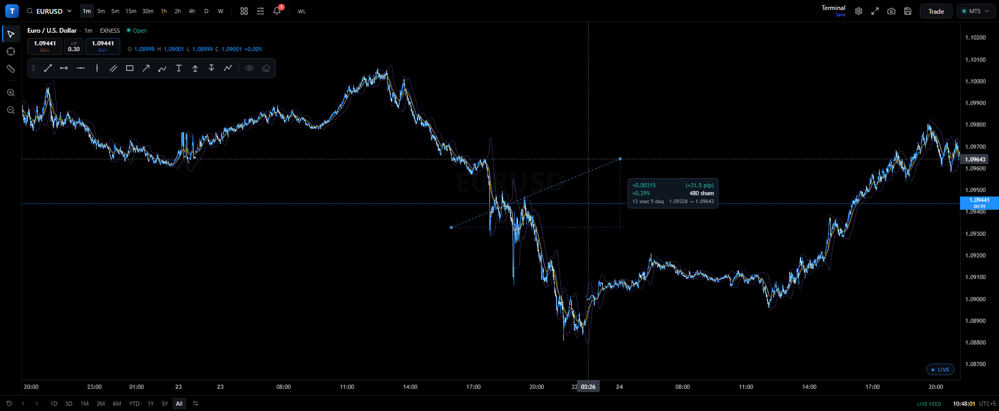
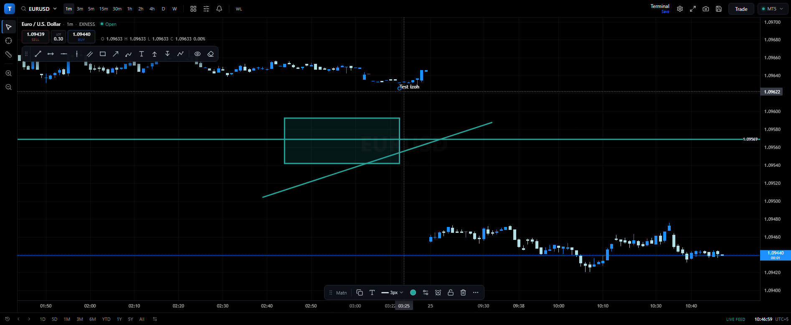
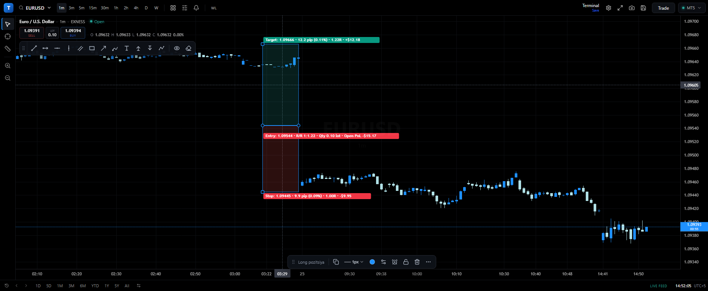
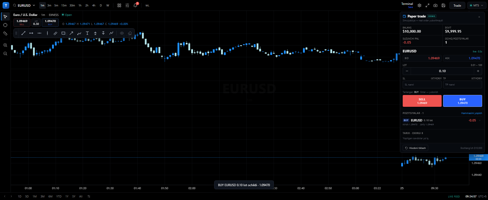
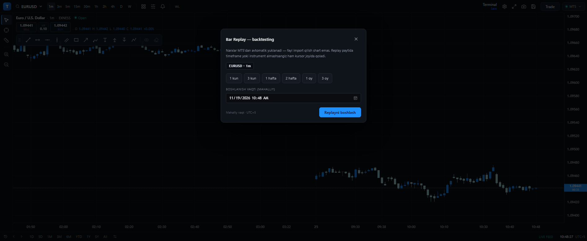

# OpenTradingView

**A TradingView-style forex & gold terminal that runs on real MetaTrader 5 data — locally, in your browser.**

Ticks stream in every ~0.3 s, history scrolls back years, and everything you draw behaves like the
real thing. Trading is **simulated** (paper trading): the MetaTrader 5 connection is read-only.



---

## Why this exists

Most "charting lookalike" projects are static demos. This one is a working desktop-class terminal
fed by a live MT5 terminal: real bid/ask, real history, bar replay and a full drawing suite.

- **Real data, no API keys** — the backend talks to the local MT5 terminal over its Python IPC.
- **Simulated trading only** — orders, PnL and history live in the browser; no broker order is sent.
- **No TradingView assets** — the UI is an independent recreation built on the open-source
  (Apache-2.0) [`lightweight-charts`](https://github.com/tradingview/lightweight-charts) library.

## Features

**Chart**
- Candles / bars / line / area, 10 timeframes (`1m 3m 5m 15m 30m 1h 2h 4h 1D 1W`; 3m and 2h are resampled)
- 8 instruments: 7 majors + XAUUSD, symbol search (<kbd>Ctrl</kbd>+<kbd>K</kbd>), watchlist
- Infinite history scroll — drag past the left edge, older bars are fetched in chunks
- Vertical price panning (pulling the chart up/down unlocks the price scale), `auto` to re-arm
- Period buttons (`1D 5D 1M 3M 6M YTD 1Y 5Y All`), OHLC legend, countdown, crosshair & magnet modes
- Indicators: EMA 20, EMA 50, SMA 200, Bollinger Bands (20, 2)
- Measure tool: click → click, reports Δ price, Δ pips, Δ %, bar count and duration

**Drawings** — 12 tools: trend line, ray, horizontal/vertical line, channel, rectangle, arrow, brush,
text, long/short position, polyline, measure
- Click a drawing to edit it: **drag an endpoint handle to stretch/rotate**, drag the body to move it
- Style panel: color, width (1–4 px), style (solid/dashed/dotted), fill, lock, duplicate, delete, bring to front
- Trend-line alerts, per-symbol storage, drawings survive timeframe and symbol switches

**Long / Short position tool (TradingView-style)**
- One click places entry, **target and stop automatically at 1:1** (sized from recent volatility)
- Drag the TP/SL square handles to change R/R, the entry line to move the position, the right handle to resize time
- Labels show Target / Entry / Stop price, pips, %, R multiple, lot size and $ amounts, plus live **Open PnL**
- Labels appear only while the pointer is over the position **or it is selected** — otherwise just the green/red zones

**Alerts** — price alerts on any symbol with crossing semantics (an alert placed at the current price
does not fire immediately), browser notification + sound + toast, persisted locally.

**Paper trading** — market BUY/SELL at bid/ask, lots 0.01–100, SL/TP auto-close, live PnL,
trade history, starting balance $10,000, all in `localStorage`.

**Bar Replay (backtest)** — pick a date, play/pause/step at 0.5×–8×, jump to any moment.
History comes from MT5 automatically. **Switching timeframe or symbol keeps the replay cursor**
instead of restarting; paper trades fill at the replay price and SL/TP are checked against the
replayed bar's high/low.

## Tech stack

| Layer | Choice |
|---|---|
| Feed | MetaTrader 5 terminal + `MetaTrader5` Python package (100 ms tick poll) |
| API | FastAPI + WebSocket (bar deltas, 300 ms heartbeat), uvicorn |
| UI | React 19, TypeScript (strict), Vite 6, zustand 5 |
| Charts | `lightweight-charts` v5 |

## Requirements

- Windows with **MetaTrader 5** installed and logged in (any broker; the account needs no trading rights)
- Python 3.12 with `MetaTrader5`, `fastapi`, `uvicorn`
- Node.js 20+

## Quick start

```bat
start.bat
```

Then open <http://127.0.0.1:5173>. Two helper windows open (API + UI) — keep them running, and keep the
MT5 terminal logged in.

Manual start:

```bash
# 1) API — port 8787
cd backend
python -m pip install -r requirements.txt
python -m uvicorn main:app --host 127.0.0.1 --port 8787

# 2) UI — port 5173
cd frontend
npm install
npm run dev
```

> **Python on PATH:** if `python -c "import MetaTrader5"` fails (on Windows `python` can be the
> Microsoft Store alias), use the launcher instead: `py -3 -m uvicorn main:app ...`.
> `start.ps1` picks a working interpreter automatically: `MT5_PYTHON` → `py -3` → `python` → `python3`.

### Configuration

| Variable | Default | Meaning |
|---|---|---|
| `MT5_TERMINAL_PATH` | *(empty)* | Path to `terminal64.exe`. Empty = attach to the already running terminal |
| `MT5_PYTHON` | `python` on `PATH` | Interpreter used by `start.ps1` |

Backend tuning lives in [`backend/config.py`](backend/config.py) (poll cadence, resampling, gap filling).

## Architecture

```
MT5 terminal  --MetaTrader5 (Python, local IPC)-->  backend/feed.py
                                                         |  tick poll 100 ms
                                                         |  M1..W1 candles, 3m/2h resample
                                                         v
                                                  backend/main.py (FastAPI /ws)
                                                         |  bar deltas + 300 ms heartbeat
                                                         v
                                        frontend: React 19 + lightweight-charts v5
```

### HTTP / WS API

| Endpoint | Description |
|---|---|
| `GET /api/health` | feed state, broker time offset, uptime |
| `GET /api/symbols` | instrument metadata (digits, point) |
| `GET /api/history?symbol=EURUSD&tf=1m&count=500` | latest bars |
| `GET /api/history?...&before=<unix>` | bars **older** than a timestamp (infinite scroll) |
| `WS /ws` | `sub`/`unsub`/`more` commands; `init`/`bar`/`bars`/`heartbeat` messages |

## Project layout

```
backend/     FastAPI + MT5 bridge
  config.py    symbols, timeframes, poll cadence
  feed.py      MT5 polling, resampling, history paging
  main.py      HTTP + WebSocket API
frontend/    React + TypeScript UI
  src/components/  chart, panels, toolbars, dialogs
  src/lib/         drawing geometry, paper engine, replay, alerts, feed client
tools/       headless-Edge (CDP) end-to-end harnesses, one file per feature
docs/        screenshots + the full Uzbek guide (docs/README.uz.md)
start.bat / start.ps1
```

## Screenshots

| | |
|---|---|
|  |  |
|  |  |

More: [alerts panel](docs/img/alerts.png).

## End-to-end harnesses

`tools/*.mjs` drive the real app in a headless Edge over the DevTools protocol — they assert DOM
state, drag handles with synthetic mouse events and save screenshots. Start both servers first, then:

```bash
node tools/pos.mjs     # long/short tool: auto 1:1, TP/SL/width drags, hover-only labels
node tools/edit2.mjs   # every drawing tool: create, edit, reload
node tools/replay.mjs  # bar replay + multi-timeframe
```

Each harness opens its own temporary browser profile, so they never touch your normal session.

## Known limitations / roadmap

- Pending orders (limit/stop) are not implemented yet — market orders and SL/TP only
- No backtest statistics panel (R-multiple, expectancy, max drawdown, CSV export) yet
- Drawings: no undo/redo or object tree
- Only market-watch symbols exposed by the attached MT5 account are available

## Disclaimer

This project is **not affiliated with, endorsed by or connected to TradingView**. No TradingView
branding, assets or code are included; the interface is an independent recreation and
`lightweight-charts` is used under its Apache-2.0 license.

The MT5 connection is read-only — no order is ever sent to a broker. Paper trades are stored in your
browser only. Provided as-is, without warranty; use at your own risk.

License: not specified yet.
